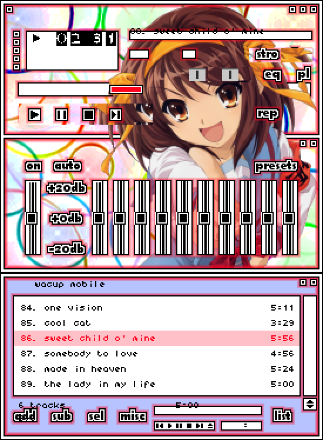

# WACUP Mobile

A native Android music player built around **classic Winamp 2.x skins** (`.wsz`) —
the same skin files WACUP and Winamp use. No emulator, no Wine: real Android audio,
real media notification, real Bluetooth/lock-screen controls.

Status: **0.1, first working skeleton.** Expect rough edges; see *What works* below.

**Download the APK:** https://github.com/Aaron-1992/WACUP-Mobile/releases/download/apk-latest/app-debug.apk
(rebuilt on every push by GitHub Actions)

## What works

- Classic skin engine: `main.bmp`, `cbuttons.bmp`, `titlebar.bmp`, `numbers.bmp`,
  `text.bmp`, `posbar.bmp`, `volume.bmp`, `balance.bmp`, `shufrep.bmp`,
  `playpaus.bmp`, `monoster.bmp`, `pledit.bmp`, `eqmain.bmp`, plus
  `pledit.txt` and `viscolor.txt`. Missing sprites fall back to drawn
  equivalents, so partial/broken skins still render.
- Main window: seek bar, volume, shuffle, repeat, transport, scrolling title,
  time display, play/pause/stop indicator, mono/stereo lights.
- Playlist window: `pledit.bmp` chrome, playlist colours from `pledit.txt`,
  per-row duration, current-track highlight, scrolling, tap to play.
- **Windows that auto-fit and dock**: by default the three windows stack flush
  like Winamp's snap-together behaviour, at the largest scale that fits, with the
  playlist growing to fill the leftover height. Drag any title bar and the window
  detaches; it then snaps to the screen edges, the centre lines and the edges of
  the other windows. *Windows…* lets you show/hide each one, re-fit, or reset the
  layout; positions and visibility persist between launches.
- **Canonical sprite geometry** straight from the format's tables (the ones
  Webamp uses), so skins land where their authors painted them — including the
  clutterbar, the 9x13 digit slots, the 4-state shuffle/repeat sprites, the EQ and
  PL buttons at 219/242 and windowshade mode.
- **Colour-keyed bitmap fonts**: `text.bmp` and `numbers.bmp` are alpha-masked and
  tinted with the skin's own palette (`pledit.txt`), using Winamp's real glyph
  order — text.bmp is *not* ASCII-ordered.
- A sample skin ships inside the APK (*menu → Load included sample skin*).
- Equaliser window: 10 bands (-12..+12 dB), on/off, eight presets, wired to the
  device equaliser on the player's audio session.
- Playlists: reads/writes `.m3u`, `.m3u8`, `.pls` — including Windows paths and
  relative entries, so a library moved from a PC still resolves.
- Media3/ExoPlayer: formats mp3, flac, ogg/opus, m4a/aac, wav, and more;
  media session = notification, lock-screen controls, Bluetooth buttons.
- Base skin is generated at runtime, so the app is usable with no skin file.

## What is missing (honest list)

- Window snapping is one-way (there is no "docked group" that moves together).
- **Modern/freeform skins** (`.wal`, the XML + maki engine). That engine is the big
  missing piece — classic skins are fully supported, modern ones are not.
- DSP plugins, input plugins (MIDI/mod/tracker), Milkdrop/AVS visualisations.
- Media library database, watch folders, CD ripping, Shoutcast, remote control.
- Balance slider is drawn from the skin but does not yet change stereo balance.
- Only the main window can roll up (windowshade); EQ windowshade artwork is not
  used yet.
- No snapping/docking between windows, and no per-window minimise-to-tray.



*Renderer output for `samples/haruhi-suzumiya.wsz`: main, equaliser and playlist
stacked the way auto-fit arranges them on a phone.*

## Build the APK

**Option A — GitHub Actions (recommended, no PC needed)**

The workflow in `.github/workflows/build-apk.yml` builds a debug APK on every push
and publishes it as a release at `…/releases/tag/apk-latest`.

Actions needs no local toolchain and works on a free public repo. A failing build
commits its compiler output to `ci/last-failure.log` on the branch, so errors are
readable even where the Actions log host is blocked.

**Option B — Android Studio**

```
File → Open → this folder → let Gradle sync → Build → Build APK(s)
app/build/outputs/apk/debug/app-debug.apk
```

Needs JDK 17, Android SDK 35. Android Studio generates the Gradle wrapper itself.

Install on the phone: copy the APK over, tap it, allow "install unknown apps" for
your file manager. Sideloaded builds are signed with the debug key.

## First run on the phone

1. Grant *Music and audio* access when asked (or use **Grant all-files access** in
   the menu if you keep music outside the standard folders).
2. Tap the **title bar** → *Add folder…* → pick your music folder. It scans
   recursively and starts playing.
3. Still in the menu: *Load skin (.wsz)…* → pick any Winamp skin. Skins are read
   straight from your Downloads folder, no import/copy step.
4. Tap the EQ / PL toggles on the skin to show or hide those windows. Back hides
   the playlist first.

Where skins live: anywhere you can read. If you want the whole Skin Museum on the
phone, copy the `.wsz` files into `Downloads` and load them from there.

## Layout

```
app/src/main/java/com/wacup/mobile/
  MusicEngine.java        one ExoPlayer + playlist + equaliser for the process
  PlaybackService.java    media session: notification, lock screen, Bluetooth
  MainActivity.java       hosts the windows, file/playlist/skin commands
  skin/Skin.java          .wsz loader (bitmaps, pledit.txt, viscolor.txt)
  skin/SkinLayout.java    the classic 275x116 coordinate tables
  skin/SkinPaint.java     5x6 text and 9x13 number fonts, with fallbacks
  skin/BaseSkin.java      procedurally drawn built-in skin
  playlist/Playlist.java  .m3u/.pls read + write, folder scanning
  ui/MainWindowView.java  main window drawing + hit testing
  ui/PlaylistWindowView.java
  ui/EqWindowView.java
  ui/DesktopLayout.java   floating windows: drag, z-order, show/hide, windowshade
  ui/FileBrowser.java     plain-filesystem picker
```

## Legal

Not affiliated with Winamp, WACUP or Llama Group. Skin artwork belongs to whoever
made the skin; this app only renders files you already have.
