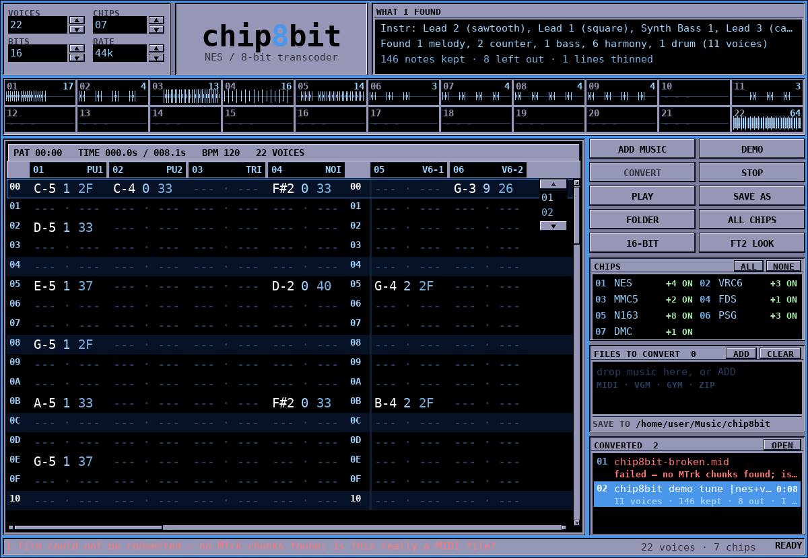
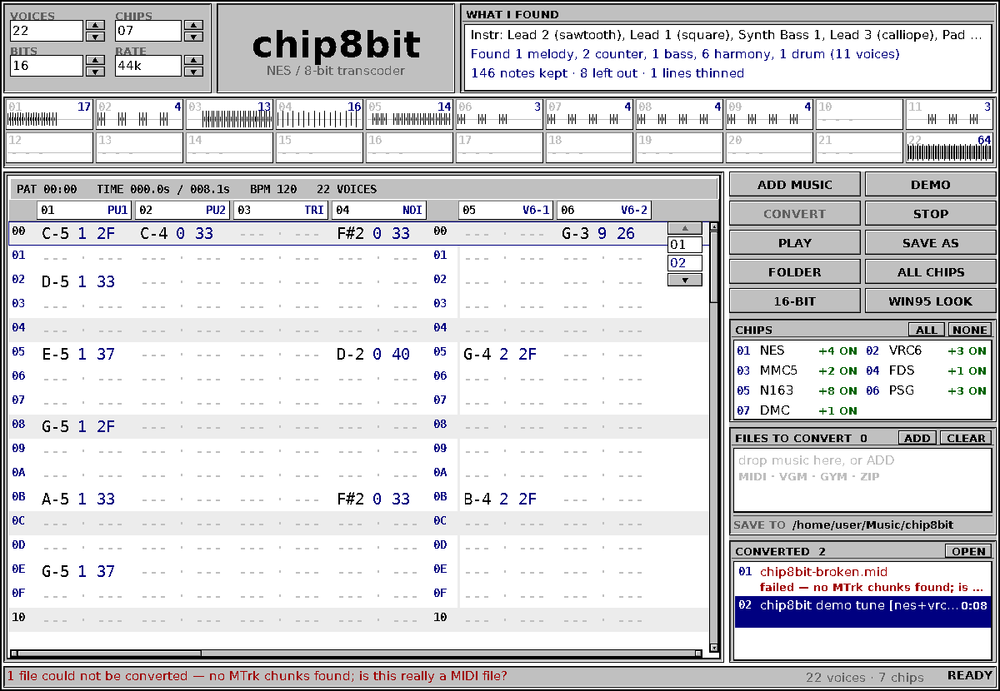
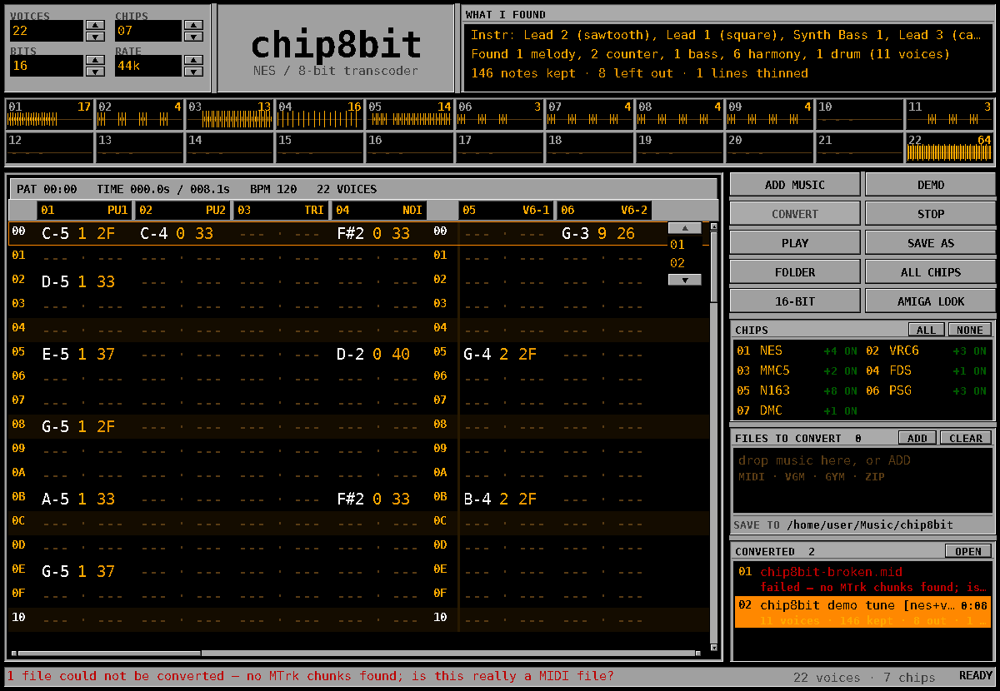

# chip8bit — NES / 8-bit chiptune transcoder

Takes **MIDI files** (and **game music logs**: VGM, VGZ, GYM, or a `.zip` of them) and
re-composes them for the NES sound chip, then renders 8-bit audio.

* **its own window, in 1995** — a FastTracker II desk: a thin blue window edge, one
  lavender surface with every panel cut into it, per-channel waveform scopes, and the
  pattern page with row numbers down the side of every four channels and hex
  note/instrument/volume columns. Windows 95 and Amiga Workbench looks are one click
  away; no browser, no server, no install;
* **it reads the MIDI before it converts it** — tracks are split into monophonic
  voices by voice leading, instruments and drum pieces are identified, tempo, meter
  and key are read, and the result is shown in the window;
* **sampled drums** — kick, snare, hats, toms and cymbals are real samples played
  through the console's delta channel, not noise bursts pretending to be drums;
* **no click-and-fizz** — every note has an attack and a release, and the mix is
  gently filtered, so it sounds like music rather than a test tone;
* **every hardware voice is used, and extension chips can be switched on** (4 → 22);
* **channels are not crammed** — when every voice is busy the note is left out and
  counted, rather than squeezed in as an arpeggio. The melody, bass and drums always
  get a voice first, so the important line is never the one that gets dropped;
* **the tune survives the tempo** — a 226 BPM game tune is full of 33 ms sixteenth
  notes; they are given the shortest length the chip can actually articulate
  instead of being thrown away as "too short";
* **a mix, not a pile** — the melody sits on top, the bass under it, the chord bed
  under both, and no more than a handful of duplicate lines play at once.

## The window



Double-click **`chip8bit.exe`**. Its own window opens (pygame/SDL — a normal desktop
window, no browser anywhere), laid out like FastTracker II v2.04: one lavender desk
with the panels **cut into** it, so nothing floats on a coloured background.

1. **Add music** — drag files onto the window, press *ADD MUSIC* (the real Windows
   file dialog), or drop them straight onto `chip8bit.exe`. MIDI, VGM/VGZ, GYM, and
   `.zip` of any of those. Anything else is refused immediately with the reason
   rather than failing halfway through a batch. *DEMO* queues a tune to play with.
2. **Pick chips** — the `CHIPS` box lists what each extension chip adds; `ALL` and
   `NONE` in its title line switch the whole set. `VOICES` and `CHIPS` in the header
   follow along (4 → 22 voices). The choice is remembered between runs.
3. **Convert** — press *CONVERT*. The button counts what is waiting (`CONVERT 3`)
   and the list keeps you posted, one row per file:

   ```
   FILES TO CONVERT  3                       [ADD] [CLEAR]
   01  nsmb_athletic.mid                            100%  [x]
   02  chip8bit demo tune.mid                        WAIT  [x]
   03  broken.mid                                    WAIT  [x]
   1/3  nsmb_athletic.mid — Rendering                    33%
   SAVE TO  C:\Users\you\Music\chip8bit
   ```

   A song that fails comes back red with the reason, **stays in the list**, and
   *CONVERT* retries it — the rest of the batch is never abandoned. *STOP* silences
   playback. `ENTER` also starts a conversion.
4. **Listen and take it away** — converted songs appear under `CONVERTED` with their
   length, voice count and `notes kept · left out`; click one to select it, *PLAY*
   plays it, *SAVE AS* copies it anywhere, *OPEN* (or the `SAVE TO` line) shows the
   output folder in Explorer. The files are already on disk in that folder — saving
   a copy elsewhere is optional.

`WHAT I FOUND` in the header shows the analysis of the selected song: the
instruments it identified, how the tracks were split into voices, and
`2980 notes kept · 6 left out · 7 lines thinned`.

### The pattern page

The big panel is a tracker pattern built from what actually went to the chips — not
a mock-up:

* one column per voice: `PU1 PU2 TRI NOI` and, with chips on, `V6-1 V6-2 V6S M5-1
  M5-2 FDS N1…N8 PSG1..3 DMC`;
* `note · instrument · volume` in hex, the tracker layout (`C-4 50 33`);
* row numbers `00`…`3F` repeated at the head of every four channels, with blue gaps
  between the groups, every fourth row striped, and the playing row highlighted and
  scrolled into view;
* the info line: `PAT 00:12  TIME 12.4s / 153.0s  BPM 226  22 VOICES` — and if two
  notes ever want the same cell, `+9 SHARED` counts them instead of hiding them;
* **click any row to play from there**; the row length is chosen from the music, so
  a 226 BPM tune still shows all of its notes. Wheel / Page Up/Down / arrows scroll
  the rows, Shift+wheel or ←/→ the channels, and a long song gets a page list down
  the right edge.

### The three looks

The look button cycles **FT2 (FastTracker II, the default) → Windows 95 → Amiga
Workbench**. Same geometry, same panels, three very different wardrobes; the choice
is remembered.

| FT2 (default) | Windows 95 | Amiga Workbench |
| --- | --- | --- |
|  |  |  |

Everything happens on your machine; nothing is uploaded and no port is opened.

## Command line

`chip8bit-cli.exe` is the same engine without a window, for batches and scripts:

```
chip8bit-cli.exe --cli song.mid --extensions vrc6,mmc5,fds --stats
chip8bit-cli.exe --cli games\*.vgz --extensions all -o converted
chip8bit-cli.exe --cli --list-extensions
```

`--bits 8` gives you the crunch; the default is 16-bit. `--no-drums` falls back to
the noise channel. `--no-sharing` is the default already: when no voice fits, the
note is dropped and counted, never arpeggio-crammed into another channel.

## The chips you can switch on

| flag | adds | channels |
| --- | --- | --- |
| `nes` (always on) | 2A03 APU | `pulse1`, `pulse2`, `triangle`, `noise` |
| `vrc6` | Konami VRC6 | 2 extra pulses + a sawtooth (`vrc6_saw`) |
| `mmc5` | Nintendo MMC5 | 2 extra pulses |
| `fds` | Famicom Disk System | 1 wavetable channel |
| `n163` | Namco 163 | 8 wavetable channels |
| `psg` | SN76489 (Master System / Genesis) | 3 square channels |
| `dmc` | APU delta channel | sampled percussion |

That is 4 voices bare and 22 with everything enabled.

## What "understanding the MIDI" means here

1. **Track names, tempo, time signature, key signature** are read from the file's
   meta events, along with every instrument change (program), channel volume (CC7),
   expression (CC11), sustain pedal, vibrato (CC1) and pitch-bend range (RPN 0).
2. **Polyphonic tracks are split into monophonic voices by voice leading**: each new
   note continues whichever free line is nearest in pitch. A five-note pad becomes
   five voices; an eighth-note run stays one line. A chip channel is monophonic, so
   this is the step that has to happen before anything can be "placed".
3. **Each voice is named** — melody, counter-melody, bass, harmony, rhythm or
   percussion — from its register, its movement, its note lengths, how much it moves
   by step, and the General MIDI instrument it is played on. A high chord tone is
   harmony, not automatically the tune.
4. **Percussion is read as a drum kit**, piece by piece (kick, snare, rim, clap, hats,
   ride, crash, three toms, tambourine, shaker, cowbell, claves, bongos, congas), not
   as one anonymous noise channel.
5. **Articulation follows the playing**: legato lines are held through the joins so
   the chip does not re-attack every note, repeated notes keep their attack, and
   detached lines stay detached.
6. **Timbre follows the instrument**: pads get thin 12.5 % pulses, leads 25 %, bass
   the triangle, and the file's own volume/expression controls keep quiet passages
   quiet.

## How the placement rules work

A chip channel plays **one note at a time**. Anything else is a lie that sounds
like one, so:

1. each part is classified (melody / harmony / bass / drums);
2. channels are handed out in **three passes**: melody, bass and drums first — the
   lines you would actually notice — then counter-melodies and rhythm, then harmony.
   A busy file therefore never pushes the tune out of the way;
3. melody leans on the pulses, bass takes the triangle, drums take the delta
   channel (and the noise channel when it is enabled), harmony fills what is free;
4. a note that finds nothing free is first put on **any other free voice** that
   can plausibly play it;
5. percussion may **take a channel from a hi-hat** — a missing backbeat is worse
   than a clipped hat, and that is what real NES drum code does;
6. parts that duplicate each other note for note are folded into one;
7. every line keeps **its own channel** once it has one, so a chord sounds like a
   chord and the part does not jump between voices;
8. with extension chips on, at most a **handful of separate lines** play at once
   (one melody, one rhythm, a few counter-melodies, the strongest chord voices).
   A full-band MIDI export has five guitar parts and eleven harmony lines; that is
   not an arrangement, it is mud, so the strongest lines are kept and the rest are
   reported as thinned;
9. anything left over is **dropped and counted**, not smuggled in — there is no
   arpeggio cramming. The header and the result card say exactly how many notes
   were left out or thinned, and where they came from.

Measured on a real 226 BPM game tune (3806 notes, 2.5 minutes — the athletic-theme
case the tests now cover with a generated stand-in):

| chips | notes kept | left out | lines thinned | voices used |
| --- | --- | --- | --- | --- |
| bare NES (4) | 3335 | 286 | – | 4 |
| + VRC6 (7) | 3435 | 186 | – | 7 |
| all chips (22) | 2980 | 6 | 7 | 13 |

On the built-in demo tune (169 notes): bare NES keeps 121 (34 left out: 24 drum,
10 harmony), all chips keep 146 and thin one spare line. Nothing is ever dropped for
being "too short" any more.

`--stats` (and the result card) tells you the exact count of each outcome, including
which lines were thinned and why.

## How it sounds

| piece | what it does |
| --- | --- |
| drums | a 17-piece kit (kick, snare, rim, clap, hats, ride, crash, toms, tambourine, shaker, cowbell, claves, bongos, congas) synthesised from scratch and quantised to the delta channel's 7-bit 33.1 kHz output — the grit is deliberate |
| notes | 4 ms attack, musical decay, 12 ms release: no digital snaps |
| pulses | 12.5/25/50/75 % duty, 4-bit volume, vibrato follows the MIDI CC1 |
| triangle | the real 32-step staircase, no volume control (that is the point) |
| VRC6 / MMC5 / FDS / N163 / PSG | sawtooth, extra pulses, and wavetables, each rendered the way its chip does it |
| output | gentle low-pass, DC blocker, then the APU's non-linear mixer curve |

## Honest limits

* VGM can only address the NES APU and the SN76489, so `--export-vgm` leaves the
  VRC6/MMC5/FDS/N163 notes out of the log. The WAV always has all of them.
* The delta channel here plays the built-in kit; it is not a sample player for
  arbitrary user samples yet.
* Supported input: MIDI (`.mid .midi .rmi .kar`), VGM/VGZ, GYM, `.zip`. NSF, SPC and
  PSF are different formats — the tool says so instead of guessing.
* A dense orchestral MIDI will still lose inner voices: 22 monophonic voices is a
  hard ceiling, and the tool reports exactly what it dropped.

## Development

```
python -m pip install -r requirements.txt      # pygame, for the window only
python tests/run_tests.py                      # pipeline self test
python chip8bit.py --selftest                   # opens the window headlessly, clicks it
python chip8bit.py                              # the app
python chip8bit.py --cli song.mid --extensions all --stats
```

The converter is standard library only; pygame is needed for the window and for
nothing else.
