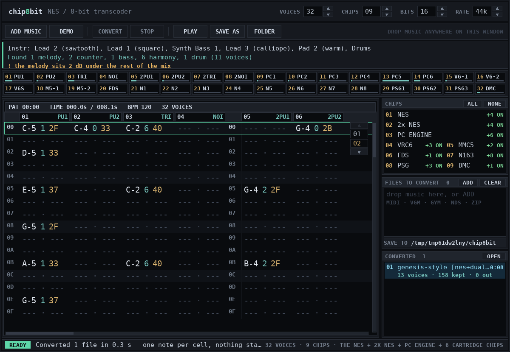
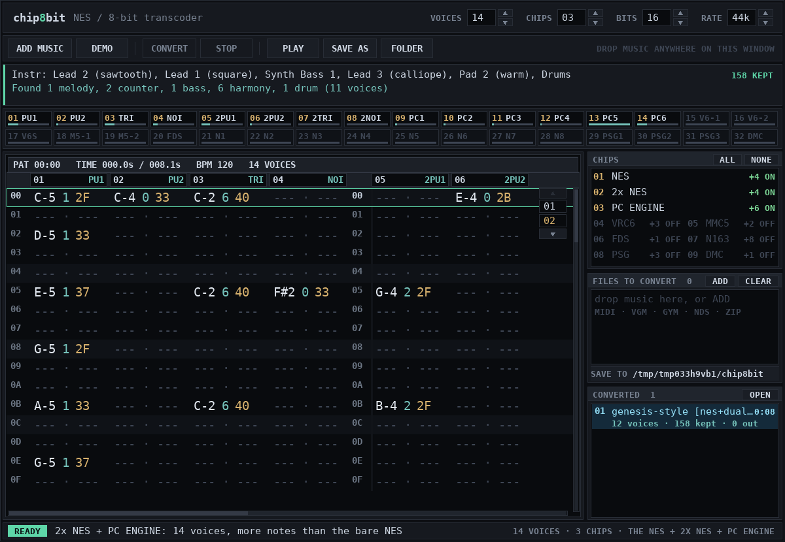
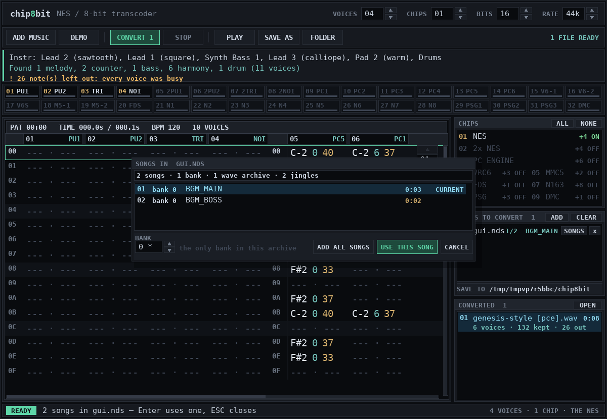
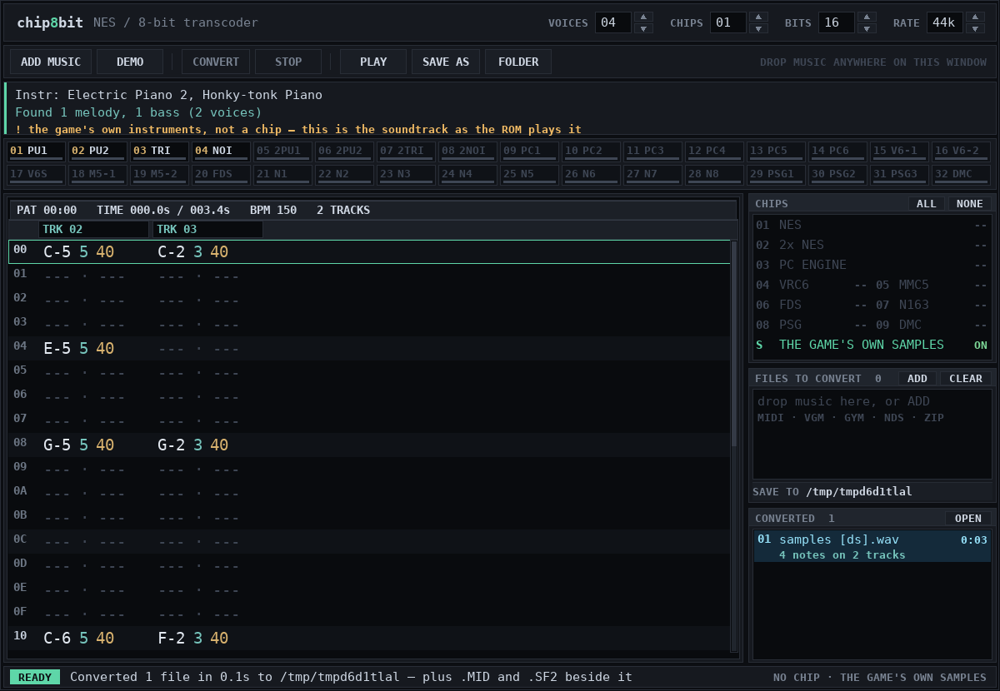

# chip8bit — NES / 8-bit chiptune transcoder

Takes **MIDI files** (and **game music logs**: VGM, VGZ, GYM, **Nintendo DS ROMs**, or a
`.zip` of them) and re-composes them for the NES sound chip, then renders 8-bit audio.

* **its own window, a tracker desk in dark** — one flat near-black desk, hairline
  borders, one mint accent, monospaced text: a pattern page with row numbers down the
  side of every four channels and hex note/instrument/volume columns, channel meters
  across the top and a toolbar under them. No bevels, no skins, one look; no browser,
  no server, no install;
* **it reads the MIDI before it converts it** — tracks are split into monophonic
  voices by voice leading, instruments and drum pieces are identified, tempo, meter
  and key are read, and the result is shown in the window;
* **sampled drums** — kick, snare, hats, toms and cymbals are real samples played
  through the console's delta channel, not noise bursts pretending to be drums,
  and the kit is levelled like a kit instead of like eight separate files;
* **no click-and-fizz** — every note has an attack and a release, and the mix is
  gently filtered, so it sounds like music rather than a test tone;
* **every hardware voice is used, and whole consoles can be switched on** — a
  second NES APU (4 → 8) and a PC Engine (4 → 10), plus the cartridge chips, up to
  32 voices. Any of the three consoles can be switched off, so `PC Engine` with the
  NES off is *six PC Engine voices* — a PC Engine arrangement, not a NES with six
  extras — and its file is named `[pce]`, not `[nes+pce]`. The PC Engine's six channels each load their own 32-step waveform, so
  a flute, a string section and an organ are three different waves, not three
  squares;
* **channels are not crammed** — when every voice is busy the note is left out and
  counted, rather than squeezed in as an arpeggio. The melody, bass and drums always
  get a voice first, so the important line is never the one that gets dropped;
* **the tune survives the tempo** — a 226 BPM game tune is full of 33 ms sixteenth
  notes; they are given the shortest length the chip can actually articulate
  instead of being thrown away as "too short";
* **a mix, not a pile** — the melody sits on top, the bass under it, the chord bed
  under both, and no more than a handful of duplicate lines play at once;
* **and the other answer, for a DS ROM** — `--samples` (or the samples row under the
  chips) stops converting and simply plays the archive's own instruments at once:
  the soundtrack as the game plays it, named `[ds]` and labelled *no chip*, so you can
  hear the original next to any conversion of it.

## The window



Double-click **`chip8bit.exe`**. Its own window opens (pygame/SDL — a normal desktop
window, no browser anywhere), laid out like a tracker: the live numbers and the
toolbar across the top, the pattern page as the biggest thing on the desk, the chips
and the file list down the right. It is painted once, dark — near-black panels, single
hairline borders, no bevels or grooves anywhere.



1. **Add music** — drag files onto the window, press *ADD MUSIC* (the real Windows
   file dialog), or drop them straight onto `chip8bit.exe`. MIDI, VGM/VGZ, GYM, a
   Nintendo DS `.nds`/`.sdat` (see below), and `.zip` of any of those. Anything
   else is refused immediately with the reason rather than failing halfway
   through a batch. *DEMO* queues a tune to play with.
2. **Pick chips** — the `CHIPS` box lists what each chip adds, and every row is a
   switch; `ALL` and `NONE` in its title line switch the whole set. The first three
   rows are the consoles — `NES` (the plain 2A03, on to start with), `2x NES` (a
   second APU) and `PC ENGINE` — and the rest are the cartridge chips. Clicking
   `NES` off leaves the others playing on their own: `PC ENGINE` alone is a PC
   Engine, six voices, no APU. A console has to stay on, so the last one cannot be
   switched off — the status line says why instead of leaving you with nothing.
   `VOICES` and `CHIPS` in the top strip follow along (4 → 32 voices) and their
   arrows add or drop one chip, while `BITS` picks 8 or 16 and `RATE` walks 22k /
   32k / 44k / 48k / 96k. Every spinner in the top strip is a control that does what
   its number says. The choice is remembered between runs.
3. **Convert** — press *CONVERT*. The button counts what is waiting (`CONVERT 3`)
   and the list keeps you posted, one row per file:

   ```
   FILES TO CONVERT  3                       [ADD] [CLEAR]
   01  nsmb_athletic.mid                            100%  [x]
   02  chip8bit demo tune.mid                        WAIT  [x]
   03  broken.mid                                    WAIT  [x]
   1/3  nsmb_athletic.mid — Rendering                    33%
   SAVE TO  C:\Users\you\Music\chip8bit
   ```

   A song that fails comes back red with the reason, **stays in the list**, and
   *CONVERT* retries it — the rest of the batch is never abandoned. *STOP* silences
   playback. `ENTER` also starts a conversion.
4. **Listen and take it away** — converted songs appear under `CONVERTED` with their
   length, voice count and `notes kept · left out`; click one to select it, *PLAY*
   plays it, *SAVE AS* copies it anywhere, *OPEN* (or the `SAVE TO` line) shows the
   output folder in Explorer. The files are already on disk in that folder — saving
   a copy elsewhere is optional.

The strip under the toolbar shows the analysis of the selected song: the instruments
it identified, how the tracks were split into voices, and the totals on the right —
`2980 KEPT · 6 OUT`.

### The pattern page

The big panel is a tracker pattern built from what actually went to the chips — not
a mock-up:

* one column per voice: `PU1 PU2 TRI NOI` and, with chips on, `V6-1 V6-2 V6S M5-1
  M5-2 FDS N1…N8 PSG1..3 DMC`;
* `note · instrument · volume` in hex, the tracker layout (`C-4 50 33`);
* row numbers `00`…`3F` repeated at the head of every four channels, with a dark gap
  between the groups, every fourth row striped, and the playing row highlighted and
  scrolled into view;
* the info line: `PAT 00:12  TIME 12.4s / 153.0s  BPM 226  14 VOICES` — and if two
  notes ever want the same cell, `+9 SHARED` counts them instead of hiding them;
* **click any row to play from there**; the row length is chosen from the music, so
  a 226 BPM tune still shows all of its notes. Wheel / Page Up/Down / arrows scroll
  the rows, Shift+wheel or ←/→ the channels, and a long song gets a page list down
  the right edge.

### One look, and it is dark

There used to be three skins — a lavender FastTracker II desk, a Windows 95 bevel
fest and an Amiga Workbench one — and a `LOOK` button that cycled them. They are
gone: one dark desk, FamiTracker's layout, and nothing to switch. A settings file
from an older build that still says `"look": "win95"` is read and the key ignored, so
an upgrade cannot put the bevels back on screen.

The same pass is what stopped the stutter. A frame used to be repainted sixty times
a second whether or not anything had changed, the pattern page walked every note of
the song three times per frame, and every scrollbar built a font object per draw. Now
the pattern rows, the channel meters and every repeated string are rendered once and
kept, the window only repaints when something actually happened (or while music plays
or a batch runs), and the garbage collector is left alone long enough that it no
longer stops the window mid-frame. On a three-minute, 1890-note file a frame went
from 19 ms to about 4 ms, with no frame over 16 ms in a 600-frame run.

Everything happens on your machine; nothing is uploaded and no port is opened.

## Command line

`chip8bit-cli.exe` is the same engine without a window, for batches and scripts:

```
chip8bit-cli.exe --cli song.mid --extensions vrc6,mmc5,fds --stats
chip8bit-cli.exe --cli games\*.vgz --extensions all -o converted
chip8bit-cli.exe --cli song.mid --no-nes --extensions pce --stereo
chip8bit-cli.exe --cli --list-extensions
```

`--no-nes` takes the first NES APU out of the console. With `--extensions pce` that
is a PC Engine on its own (six voices, `song [pce].wav`); with `--extensions dual`
it is the second APU alone (`song [dual].wav`); with no console left over the run
is refused and says so.

`--samples` is the one mode that is not a conversion: on a DS ROM it plays the
archive's own instruments (see "Playing the game's own instruments"), names the file
`[ds]`, and says so; on anything else it stops and tells you that a game's own
samples only exist in a DS file. `--sequence NAME` and `--bank N` pick the song.

`--bits 8` gives you the crunch; the default is 16-bit. `--stereo` writes two
channels, and with a PC Engine in the console it is real stereo: the chord and
counter lines are panned a step or two either side of the lead, everything else
stays centred. `--no-drums` falls back to the noise channel. `--no-sharing` is the default already: when no voice fits, the
note is dropped and counted, never arpeggio-crammed into another channel.

## The chips you can switch on

| flag | adds | channels |
| --- | --- | --- |
| `nes` (on unless `--no-nes`) | 2A03 APU | `pulse1`, `pulse2`, `triangle`, `noise` |
| `dual` | **a second NES APU, in parallel** | 2 pulses, a triangle and a noise channel — 8 voices of the hardware you already know |
| `pce` | **Hudson PC Engine (HuC6280)** | 6 channels, each with its own 32-step waveform in RAM, 5-bit volume and stereo pan |
| `vrc6` | Konami VRC6 | 2 extra pulses + a sawtooth (`vrc6_saw`) |
| `mmc5` | Nintendo MMC5 | 2 extra pulses |
| `fds` | Famicom Disk System | 1 wavetable channel |
| `n163` | Namco 163 | 8 wavetable channels |
| `psg` | SN76489 (Master System / Genesis) | 3 square channels |
| `dmc` | APU delta channel | sampled percussion |

That is 4 voices bare, 14 with the two consoles added, and 32 with everything on —
and the NES itself is one of the switches, not the floor everything else sits on.

## The two whole consoles

The cartridge chips each add a voice or two. These two are a different kind of
switch: they are another machine playing along, and they change what the converter
can do with a file.

**`dual` — a second NES.** Two more pulses, another triangle and another noise
channel, identical to the first console's. Nothing clever: it is the cheapest way
to stop dropping half a tune's harmony lines, and on the 226 BPM test tune it takes
the "left out" count from 33 notes to 0. Cross-check it in a debugger against any
"2x NES" tracker patch and the voices line up one for one.

**`pce` — the PC Engine.** Six channels, and the thing that makes this console
different: there is no fixed waveform. Each channel holds **32 samples of 5-bit
audio in its own little RAM**, a volume that goes to 31 steps instead of 15, and a
pan register. So the converter loads a different wave per note, from the
instrument the MIDI names:

| the file says | the wave RAM gets |
| --- | --- |
| flute, recorder, pan flute | a sine with a touch of second harmonic |
| strings, ensemble, choir | a fat, sawtooth-like 6-partial wave |
| organ | octave-stacked partials (1, 2, 4, 8) |
| brass | bright, 5 partials, closes up as it is played |
| piano, guitar | struck partial sets, each its own |
| bells, glockenspiel, FX | inharmonic (1, 4, 7, 11) — metallic |
| any "Lead" patch | the square or pulse the patch asks for |
| bass | few partials, because a bass down there needs body, not fizz |

Two more rules on top: a line whose instrument has a real timbre (flute, strings,
organ, brass, piano, guitar…) is offered the PC Engine's channels *first* when one
is free, and a note three octaves up gets a simpler wave, because a busy wave up
there is aliasing rather than brightness. Channels 5 and 6 switch to noise,
exactly as on the real hardware, so a kick or a snare can use them when the delta
and noise channels are taken — but never by pushing the tune off them. With `--stereo`
on, the chord and counter lines sit a couple of pan steps either side of the lead,
and the tune and the bass stay down the middle. `--stats` prints the wave set:

```
  PC Engine wave RAM                       : FLUTE x41, STRINGS x28, ORGAN x12
```

![a PC Engine with the NES switched off: six PC Engine voices, `tune [pce].wav`](docs/window-pce-only.png)

**The NES is a switch as well.** `2x NES` and `PC ENGINE` are not extras hung off
the 2A03: click `NES` off and the console is whatever is left. `PC ENGINE` on its
own is six PC Engine voices (`[pce]` in the file name, `--stereo` for the panning),
`2x NES` on its own is the second APU's four voices (`[dual]`), and both together
are ten. A click that would leave no console at all is refused with a reason in the
status line rather than leaving you with an empty desk.

Both go into the VGM log too, because the format has real support for them: the
second NES APU uses the spec's dual-chip bit (bit 30 of the clock value, bit 7 of
the register address), and the PC Engine is the HuC6280 command `0xB9` with its
clock at header offset `0xA4` — including the 32-step wave upload, which is what
a real driver writes. Only the VRC6/MMC5/FDS/N163 still cannot be logged.

## Nintendo DS ROMs

Drop a `.nds` on the window (or a `.sdat`, or a bare `.sseq`) and the tool pulls the
music and the instrument bank out of it, then converts the song like any other file:

* **the sequence** is read from the archive's SSEQ — tempo, every track, track
  volume, expression, transpose, program changes, vibrato depth and ties all arrive
  the way the game's driver plays them, and a jump loop is played once rather than
  followed forever;
* **the tempo is read from the head of the sequence**, the short command stream
  between the track table and the first track, where an SSEQ keeps the settings that
  belong to the whole song. Nothing names that region as a track, so a reader that
  only walks tracks plays *every* song at the default 120 BPM: New Super Mario Bros.
  is written at 200 and 226, and at 120 its overworld theme came out at two thirds
  speed and half the right rhythm. That one line of code was most of "it sounds
  nothing like the song";
* **every instrument is measured from its own sample.** A DS "program change" is a
  slot in the game's bank, not a General MIDI program, so the bank is what knows what
  the instrument is: each slot's decoded sample gives its brightness (which sets the
  pulse width — 12.5 % for a bright sound, 50 % for a warm one), its envelope (a
  plucked shape or a held one) and its pan. Treating slot numbers as GM programs
  made a piano, a string pad and a bass line arrive as the same 50 % square;
* **the bank** is read from the SBNK plus the SWAR wave archives it points at:
  direct instruments, key-range instruments and the eight-region kind, with each
  zone's root key, pan and loop points;
* **two files are written next to the `.wav`** — `<song>.mid` (a real Standard MIDI
  File, format 1, 48 ticks per quarter, the DS's own grid) and `<song>.sf2` (a real
  SoundFont 2 with the bank's instruments and its samples, so the same music can be
  played or edited outside this tool). `--wav-only` turns both off;
* **the kit is found in the bank** — the instrument with one wave per key is the
  drum kit, and its notes become percussion instead of a bass line (see below).

**A DS soundtrack has more parts than a NES has voices**, and it is worth knowing
which is the limitation. The overworld theme is 13 tracks; four voices keep the tune,
the bass and the drums and leave about 300 notes out, and the tool says so and points
at the fix. Press **CHIPS → ALL** (or pass `--extensions dual,pce`) and the same song
keeps **2592 of 2593 notes** across 12 voices — melody, bass, drums and every counter
line, each with its own channel, at the game's own tempo. It is still square waves and
a triangle instead of the DS's samples: that is what an 8-bit conversion is, and it is
the one gap no amount of level-matching closes.

**A ROM can hold more than one sound archive, and the tool reads all of them.** New
Super Mario Bros. has two: a small one with the mini-games' jingles and a large one
with the soundtrack. Reading only the first archive found listed 33 jingles and no
music, so the "song" a conversion picked was a two-second fanfare — every note
correctly placed, nothing recognisable. It now merges every archive in the ROM into
one song list (85 songs in that game), keeps each sequence pointing at the bank of
its own archive, and numbers the list continuously.



Where the ROM keeps several songs, its row in `FILES TO CONVERT` shows which song it
will convert out of how many (`1/24  BGM_MAIN`) and a **SONGS** button opens the song
browser: every sequence in the archive, numbered, with its bank, **how long it is**
(**13:45**), the current one marked, a scroll wheel for long archives and a bank box
for the odd song that uses a different bank. The lengths matter, because a game's
song list is half jingles and half music: the browser decodes the archive off the
drawing thread when the file is added and says how many songs are jingles under ten
seconds, so "which one is the tune" is a question about minutes rather than about
internal names like `BGM_AMB_WATER` (which, it turns out, has no notes at all). Pick with the mouse (a double click takes it), `↑` `↓` `PageUp`
`PageDown` `Home` `End` then `ENTER`, or type the first letters of a song's name to
jump to it, or `ESC` to leave it as it was. *ADD ALL SONGS*
queues every song in the archive as its own row, so a whole soundtrack converts in
one go — and since a multi-song archive names its files after the song
(`rom BGM_BOSS [nes].wav`, `rom BGM_BOSS.mid`, `rom BGM_BOSS.sf2`), two songs of one
ROM never overwrite each other.

From the command line it is the same list:

```
chip8bit-cli.exe --cli --list-songs rom.nds
chip8bit-cli.exe --cli rom.nds --sequence "BGM_BOSS" --stats
chip8bit-cli.exe --cli rom.nds --sequence 12 --bank 3 --stats
chip8bit-cli.exe --cli rom.nds --all-songs --stats
```

`--list-songs` prints the same list as the browser, one line per song, with its
length, its note count and a word for what it is — `jingle` under ten seconds,
`nothing to convert` for the ambience slots a lot of DS games leave in the archive:

```
 33  bank 41  BGM_VS_CHIJOU           102.3 s  1082 notes
 37  bank 30  BGM_COURSE_CLEAR          6.1 s   112 notes  jingle
 69  bank 99  BGM_AMB_WATER              nothing to convert
```

`--all-songs` converts the whole soundtrack in one go, each song into its own
`.wav`, `.mid` and `.sf2` (`--wav-only` leaves just the audio). `--sequence` takes a name fragment or a number as
`--list-songs` prints it (the
archive's own index, counting from 0); `--bank` overrides the bank the song asks for.
The window numbers the same songs from 1, the way a person counts them.

**Nothing is bundled and nothing is downloaded.** Every byte written comes out of the
file you opened; the project ships no game data. Converting a soundtrack needs your
own copy of the game.

### A whole soundtrack on the bare NES

The plain four-voice 2A03 is the default, so a DS soundtrack turned into 8-bit music
is one command — no chips to switch on:

```
chip8bit-cli.exe --cli "New Super Mario Bros.nds" --all-songs --wav-only -o "NSMB 8-bit"
```

That writes one `<rom> <song> [nes].wav` per song, named the way the game named it
(`NSMB 8-bit\New Super Mario Bros BGM_OVERWORLD [nes].wav`), and nothing else:
`--wav-only` skips the `.mid` and `.sf2` extras, which are useful for one song and
just clutter for thirty. Drop `--wav-only` if you want the extracted MIDI/SoundFont
as well. In the window it is *ADD MUSIC* on the ROM, then *ADD ALL SONGS*, then
*CONVERT* — the chips box stays on `01 NES`.

On the machine this was built on, a 22-song test soundtrack converted in 25 seconds
and a 3-minute song takes about 40. Each song is a normal `--stats` run if you want
to see what was kept.

**Drums come from the bank.** A DS bank does not label its percussion, so a drum
track is otherwise just "short low notes in the bass register" — it gets classified
as a bass line, played on the triangle, and the real bass loses its channel (drums
turn into a bass riff, which is the single worst thing that can happen to a
conversion). The reader now looks for the kit itself: the instrument type with one
voice per key, a *different* wave on every key, and a plain PSG-noise instrument.
Those notes are marked as drums, so they land on the noise channel as kick, snare
and hat. If a game's kit is laid out somewhere other than the General MIDI range, its
keys are mapped by key order onto the usual pieces (bass drum at the bottom, then
snare, hats, toms, cymbals) and the conversion says how many drum notes it found.

What carries across exactly: notes, timing, tempo, per-track volume, transpose,
program changes, key ranges, root keys, pans, sample rates, loop points, and the
sample data itself (8-bit, 16-bit and IMA ADPCM are all decoded — ADPCM is the
common case in real banks, and it is read the way the hardware reads it: one state
word for the sample, then nibbles low-first, with the size fields counting 4-byte
words rather than samples).

What does not: the DS envelope numbers (attack/decay/sustain/release use a curve of
their own, so the SoundFont gets the samples and a short release instead), the PSG
instruments some banks mix in (square/noise types, which have no sample behind them),
and streamed music (`STRM`), which is not part of an SDAT. The converter itself does
not need any of that: it re-composes the notes onto the NES's own voices, which is
the whole point of the tool.

### Playing the game's own instruments

There is one mode that does not convert at all. A DS bank *is* a set of samples with
a pitch, a loop point and a volume envelope on each of them, and the soundtrack is
already written for them — so it can simply be played:

```
chip8bit-cli.exe --cli "New Super Mario Bros.nds" --sequence BGM_CHIJO --samples
```

or the **THE GAME'S OWN SAMPLES** row under the chips in the window. Every note
becomes the archive's own SWAV, read back at `2^((note-root)/12)` of its recorded
rate, looped where the sample loops, shaped by the bank's ADSR bytes, panned where
the bank pans it. All the tracks play at once, because there is no four-voice
console to fit them into. The file is called `… [ds].wav`, not `… [nes].wav`, and
the window says **NO CHIP** while it is on: this is the soundtrack, not a cover of
it, and it would be dishonest to name it as a conversion.



Measured, on a test bank whose one instrument is a seamless looped sine: a note at
its recorded pitch comes out at exactly the sample's own frequency (500.0 Hz for a
500 Hz tone), an octave up comes out at exactly twice it (1000.0 Hz), the note holds
until the note ends and stops within its release after that. Rendering runs at the
DS's own 32768 Hz, so a note at its recorded pitch is a straight copy of the sample
with no resampling error at all.

What it is not: bit-exact hardware. The bank's ADSR bytes are rates against the
DS's own curve table; they are mapped to times here, which gets the shape right
(a 1 ms attack or a 300 ms one, a decay to a sustain level, a release) without
pretending the curve is identical. The PSG instruments some banks mix in have no
sample behind them, so those notes are played as the square they are. The chips are
drawn as out of use while this mode is on and their rows take no clicks, because a
conversion and the original cannot both be the answer; switch the samples off and
the chips you had chosen come back exactly as they were.

## What "understanding the MIDI" means here

1. **Track names, tempo, time signature, key signature** are read from the file's
   meta events, along with every instrument change (program), channel volume (CC7),
   expression (CC11), sustain pedal, vibrato (CC1) and pitch-bend range (RPN 0).
2. **Polyphonic tracks are split into monophonic voices by voice leading**: each new
   note continues whichever free line is nearest in pitch. A five-note pad becomes
   five voices; an eighth-note run stays one line. A chip channel is monophonic, so
   this is the step that has to happen before anything can be "placed".
3. **Each voice is named** — melody, counter-melody, bass, harmony, rhythm or
   percussion — from its register, its movement, its note lengths, how much it moves
   by step, and the General MIDI instrument it is played on. A high chord tone is
   harmony, not automatically the tune.
4. **Percussion is read as a drum kit**, piece by piece (kick, snare, rim, clap, hats,
   ride, crash, three toms, tambourine, shaker, cowbell, claves, bongos, congas), not
   as one anonymous noise channel. Where the file does not say a track is drums — a
   DS sequence, or a MIDI written without channel 10 — the *shape* says it: a handful
   of keys spread over four octaves, jumping between them instead of moving by step,
   every hit short. A kit read as music used to be worse than a missing track: it was
   four octaves wide, so it took the melody channels and played a burst of pitched
   noise over a tune nobody could hear. A one-key track hammered short and low (a
   kick, or a hi-hat on a fixed note) is recognised the same way.
5. **The tune is the top line, not the highest track.** A melody is whatever the ear
   follows, and the ear follows the highest sounding note most of the time, so that
   is measured: for each track, the share of the song it spends holding the top note.
   The old rule ("whichever line sits highest") handed the tune to a four-note
   sparkle line an octave above it and then threw the real melody away as harmony.
   A line that never changes pitch is never the tune, whatever its register.
6. **Articulation follows the playing**: legato lines are held through the joins so
   the chip does not re-attack every note, repeated notes keep their attack, and
   detached lines stay detached.
7. **Timbre follows the instrument**: pads get thin 12.5 % pulses, leads 25 %, bass
   the triangle, and the file's own volume/expression controls keep quiet passages
   quiet.

## How the placement rules work

A chip channel plays **one note at a time**. That is a guarantee, not an
intention: the arranger keeps every placed note in a sorted interval list and asks
it directly whether a channel is busy at a given moment, so two notes can never
end up on one voice — not because a chord met a melody, and not because a note was
placed for a moment *before* one that had already been placed. (It used to prune
that bookkeeping against the current note's start, which quietly let a long chord
land on top of a bar of melody that was already there. That is what "it shares
channels and sounds bad" was.) The rules:

1. each part is classified (melody / harmony / bass / drums);
2. channels are handed out in **three passes**: melody, bass and drums first — the
   lines you would actually notice — then counter-melodies and rhythm, then harmony.
   A busy file therefore never pushes the tune out of the way;
3. melody leans on the pulses, bass takes the triangle, drums take the delta
   channel (and the noise channels when they are enabled), harmony fills what is
   free. On a PC Engine, a line playing a flute, a string bed, an organ or a brass
   stab is offered the wave-RAM channels before the pulses, because that is the
   only place the instrument exists;
4. a note that finds nothing free is first put on **any other free voice** that
   can plausibly play it;
5. percussion may **take a channel from a hi-hat** — a missing backbeat is worse
   than a clipped hat, and that is what real NES drum code does. It only ever
   shortens a note that is *sounding* under the hit, never one that has not
   started yet;
6. parts that duplicate each other note for note are folded into one — but a drum
   hit is never folded into a pitched note (MIDI 36 is both the kick and a normal
   bass note, and folding those two together deleted the bass line under every
   kick) and two drum hits are never folded into one;
7. the triangle is the bass voice: if the song has a bass line, no other part may
   use it, or a chord tone takes it for half a beat and the bass note underneath
   disappears;
8. every line keeps **its own channel** once it has one, so a chord sounds like a
   chord and the part does not jump between voices;
9. **switching a chip on never takes music away.** There used to be a "mix stays
   readable" cap that started at eight voices and deleted whole harmony and drum
   lines — so turning on a second APU could leave you with *fewer* notes than a
   bare NES played (92 notes on four voices, 46 on eight, on one test file). It is
   gone: the channels run out on their own, and a line is only left out when there
   really is no voice free at that moment. A line budget is still available if you
   ask for one (`Options.voice_budget`), and then it says what it dropped;
10. a note outside what its voice can physically play (below A1 on a pulse, above
   C7) is **moved by whole octaves** into range instead of being rendered as a
   click or dropped — the same thing a chip composer does by hand, counted in the
   stats as "octave-folded";
11. anything left over is **dropped and counted**, not smuggled in — there is no
   arpeggio cramming. The header and the result card say exactly how many notes
   were left out or thinned, and where they came from.

Measured on the generated 226 BPM stand-in for the athletic-theme case the tests
use (384 notes, 8 seconds — small, but it is the shape of a real game tune: a lead,
a chord bed, a counter line, a bass and a busy kit):

| chips | voices available | notes kept | left out | lines thinned |
| --- | --- | --- | --- | --- |
| bare NES | 4 | 264 | 99 | – |
| second APU alone (`--no-nes --extensions dual`) | 4 | 264 | 99 | – |
| PC Engine alone (`--no-nes --extensions pce`) | 6 | 312 | 51 | – |
| + VRC6 | 7 | 333 | 30 | – |
| + 2× NES | 8 | 357 | 6 | – |
| + PC Engine | 10 | 363 | 0 | – |
| everything | 32 | 363 | 0 | – |

Read the "notes kept" column downwards: it only ever goes up. Adding a chip can
never cost you a note, which was the whole point of adding it.

On a bare NES that tune keeps the lead (96 notes), the counter line (48), the bass
(24) and the kit (96); the chord bed is what goes, because four voices cannot hold
five parts. Every one of those 99 left-out notes is a note the console had no voice
for at that moment — none of them is silently stacked on top of another one.

On the built-in demo tune (169 notes): bare NES keeps 105 (53 left out: 24 drum,
10 counter, 19 harmony), 2x NES alone keeps 140, both consoles keep 152, all chips
keep 158. Nothing is ever dropped for being "too short" any more, and nothing is
dropped because a chip is switched on.

`--stats` (and the result card) tells you the exact count of each outcome, including
which lines were thinned and why, if you asked for a budget.

## How it sounds

The point is not "sounds 8-bit", it is "sounds like a chip tune someone cared
about". Two things do most of that work, and they are the two a conversion usually
skips.

**Every voice is levelled against the others.** The chip cannot balance itself: a
pulse at volume 15, the triangle at volume 15 and a sampled kit are not equally
loud, and a MIDI file written at wildly different velocities arrives with the lead
and the harmony 18 dB apart. After rendering, each voice is measured over the parts
where it actually plays and nudged towards the level its role belongs at, measured
against the lead: the drum kit **8.5 dB under it**, the counter line 10, the bass 10
and the chord bed 14. Those gaps used to be half as wide (0, −3, −3.5, −5, −7),
which is how a tune ends up buried under its own accompaniment on four voices: "it
sounds weird and I can't make out the song". The correction is capped at 14 dB, so it
fixes a broken balance without re-writing the arrangement — and it is a *relative*
correction, because anchoring it to an absolute level made every voice hit the cap
and arrive bunched together (that is the bug this paragraph used to describe as a
feature). Measured on a full-band
MIDI: **18 dB of spread before, 7 dB after** — and by design, not by accident.

**Every instrument gets its own envelope.** A square wave with one generic fade does
not sound like a clarinet, a piano or a pad. The MIDI program decides the shape:
a piano or a plucked string starts instantly and dies away (23 dB across a one-second
note), an organ holds flat, strings and pads swell in over 60–120 ms, and brass blats
and settles. No vibrato is invented: a sustained note holds its pitch dead straight
(measured: under 1 % drift over 2.5 s), and vibrato only ever comes from the file's
own CC1 — at a fraction of a semitone, on a phase that runs with the song instead of
restarting on every note.

| piece | what it does |
| --- | --- |
| drums | a 17-piece kit synthesised from scratch — pitch-dropping kick with a beater click, two-head snare with a wire rattle, metallic 808-style hats, tuned toms with an overtone and skin noise, crash/ride with inharmonic partials — level-matched as a kit (hats 8.5 dB under the kick), with short early reflections and 7-bit noise-shaped quantisation so the decay is gritty but not buzzy |
| kick, tom | the delta channel plays them at 33.1 kHz, 7-bit, which is where the grit comes from |
| hits vary | every repeat gets a deterministic ±1.2 % length and ±0.6 dB, so a run of sixteenth hats is not a machine gun |
| notes | instrument-specific attack/decay/release, 4-bit volume steps, no digital snaps |
| pulses | 12.5/25/50/75 % duty chosen from the instrument *and* the register — thin on top so high notes are not sirens, wide at the bottom for body |
| triangle | the real 32-step staircase, no volume control (that is the point) |
| VRC6 / MMC5 / FDS / N163 / PSG | sawtooth, extra pulses, and wavetables, each rendered the way its chip does it |
| echo | **off by default** (`--echo` turns it on): a quiet tempo-aware delayed copy, two rows of the song's own grid at 7 % — the "second pulse" trick. It is a taste, and at 13 % it was too much of one |
| master | gentle low-pass, DC blocker, light bus compression, the APU's non-linear mixer curve, then an adaptive peak limiter (0.72 of full scale on a sparse tune, backing off on a dense one) so the drums keep their punch without the whole mix being turned down for them |
| result | the built-in test tune: RMS 0.34, peak 0.95, short-term level spread 2.8 dB, every voice exactly where its role belongs (the counter line and the bass 10 dB under the melody, the kit 8.5 dB under), and the true rests between phrases stay silent instead of being smeared over |

Samples are shipped as rendered audio, so there is no sample library to install —
and no copyrighted sample data anywhere: the kit is maths.

## If it doesn't sound like the song

A console with four voices cannot play a twenty-voice soundtrack, and when it runs
out the tool has to choose: it keeps the tune and drops the chord bed, and it counts
every note it drops. That is one reason a conversion is *correct* and still hard to
follow — but it is not the only one, and the other two are worse because they make
the tool sound broken:

* **the songs were played at the wrong speed.** A DS sequence keeps its tempo in its
  head, a part of the file that is not a track; only tracks were read, so every song
  ran at the default 120 BPM — two thirds speed for a 200 BPM tune, half for a 226 —
  and dragging is the surest way to make music unrecognisable;
* **every instrument was the same square wave.** A DS program change is a slot in the
  game's bank, and reading it as a General MIDI program meant a piano, a pad and a
  bass all became one 50 % pulse with one generic envelope. The bank's samples say
  what the instruments are, and they are now measured;
* **the songs were never found.** A ROM can hold several sound archives; only the
  first was read, so the song list was all jingles and the "song" converted was a
  two-second fanfare (see the DS section above);
* **the drums were read as music.** A kit has no label when it is written out as
  pitched notes, and a four-octave "melody" of kicks and hats buries the tune. It is
  recognised by shape now, and it is not allowed near a melody channel;
* **the tune was not the tune.** The highest track is often a sparkle line an octave
  above the melody; picking that as the melody threw the real one away. The top line
  is measured over the whole song now, and only one line is the tune.

Which is why the window and the command line say what happened instead of leaving
you to guess.

In the window, the last line of the strip under the toolbar shows the first thing
worth knowing about the conversion — `! 53 note(s) left out: every voice was busy`,
`! the melody sits 9 dB under the rest of the mix`, `! only 0.8 s of music — a
jingle or a sound effect?`. On the command line, ask for the whole report:

```
chip8bit-cli.exe --cli song.mid --diagnose
```

```
  song: song.mid
  16.0 s, 120 BPM, 4/4, 128 notes read, 116 placed
  melody -20.6 dB against the rest -23.9 dB (3.3 dB apart)
  voice levels: melody -20.6 dB, drum -27.0 dB, bass -29.0 dB, harmony -31.0 dB
  roles placed: bass 16, drum 32, harmony 4, melody 64
  ! 12 note(s) were left out because every voice was busy (harmony 12)
```

(the same file with `--extensions all` keeps all 128 notes and the last line reads
`nothing looks wrong: the melody leads, every note found a voice`.)

What to do with it:

* **`--extensions all`** (or the `CHIPS` panel) is the fix for a large share of
  "left out": a second APU and a PC Engine take the console to 32 voices and the
  same file then keeps everything. The report says so when it helps.
* **`--stems folder`** renders one WAV per console voice — listen to the `pulse1`
  stem to hear exactly what the melody became, without the drums on top.
* **`--list-songs`** then `--sequence NAME`. A DS ROM holds the songs *and* the
  jingles, the fanfares and the sound effects; converting the first sequence is a
  good way to hear a two-second blip. `--all-songs` converts everything, and every
  file is named after its song so you can tell them apart.
* **`--bits 8`** and **`--rate 22050`** are for the crunch, not for clarity: if a
  conversion sounds gritty or "underwater", check the `BITS` and `RATE` boxes in
  the top strip are back at `16` and `44k`. They are remembered between runs.
* **The loop is not played.** A DS sequence that loops forever is rendered once,
  from the top to the loop point, so a 40-second song is 40 seconds and not four
  minutes of the same phrase.
* **`--samples`** is the other answer: no conversion, no chip, the game's own
  instruments (see "Playing the game's own instruments" above). If a song still does
  not sound like itself after all of the above, that mode exists precisely so you
  can hear what the ROM actually plays and judge the conversion against it.

## Honest limits

* VGM can address the NES APU (and a second one, via dual-chip support), the
  SN76489 and the HuC6280, so `--export-vgm` leaves only the VRC6/MMC5/FDS/N163
  notes out of the log. The WAV always has all of them.
* The delta channel here plays the built-in kit; it is not a sample player for
  arbitrary user samples yet.
* Supported input: MIDI (`.mid .midi .rmi .kar`), VGM/VGZ, GYM, Nintendo DS
  (`.nds .sdat .sseq`), `.zip`. NSF, SPC, PSF and DS `STRM` streams are different
  formats — the tool says so instead of guessing.
* A DS ROM's SoundFont is as faithful as the bank allows: samples, key ranges, root
  keys, pans, loops and rates are exact, the DS's own envelope curves are not
  translated, and PSG-type instruments have no sample to export.
* A DS sequence's randomised commands (`0xA0`, and anything else whose length
  cannot be worked out from the command byte) end that track with a message in the
  window rather than being guessed at — the notes before it are kept.
* A dense orchestral MIDI will still lose inner voices: 32 monophonic voices is a
  hard ceiling, and the tool reports exactly what it dropped.

## Development

```
python -m pip install -r requirements.txt      # pygame, for the window only
python tests/run_tests.py                      # pipeline self test
python chip8bit.py --selftest                   # opens the window headlessly, clicks it
python chip8bit.py                              # the app
python chip8bit.py --cli song.mid --extensions all --stats
```

The converter is standard library only; pygame is needed for the window and for
nothing else.
